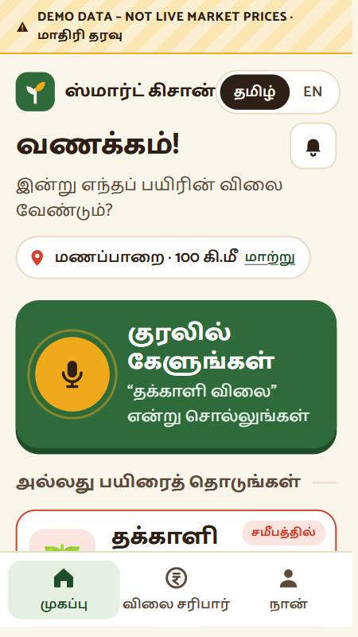
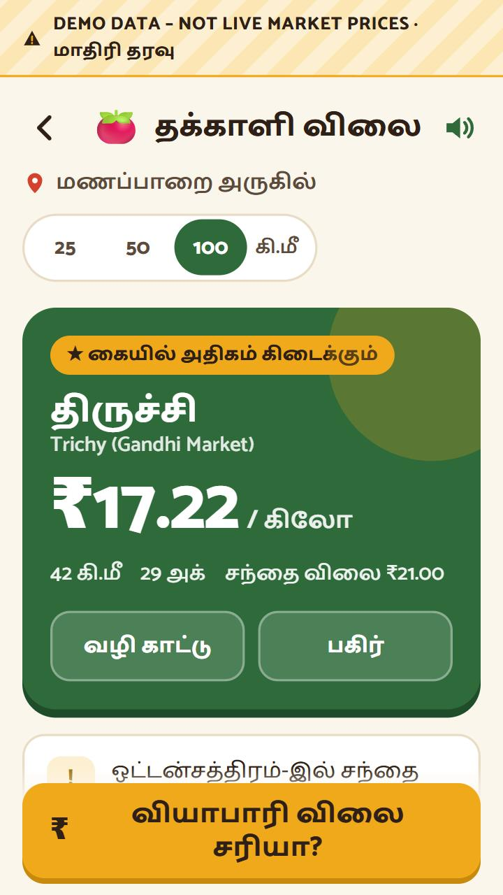
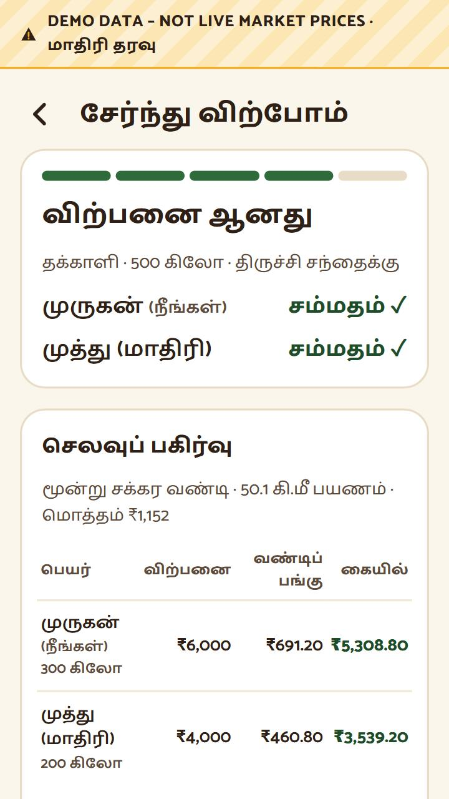
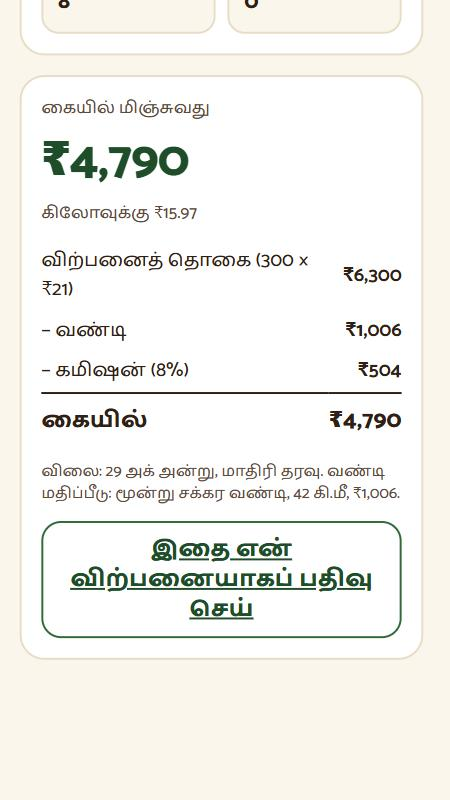

# Smart Kisaan · ஸ்மார்ட் கிசான்

**Today’s market price, in your hand.** A Tamil-first mobile web app that shows a small farmer which nearby mandi pays the most **after transport and commission**, not just the highest price on the board.

> இன்றைய சந்தை விலை, உங்கள் கையில்.

| Home | Ranked by money in hand | Sell together | Profit |
| :---: | :---: | :---: | :---: |
|  |  |  |  |

*Screens show labelled demo data until a data.gov.in API key is added.*

## The problem

About 86% of India’s farm holdings are small or marginal. The trader sees every mandi’s price; the farmer usually sees one. Government prices exist (Agmarknet, eNAM) but are shown one mandi at a time, mostly in English, as gross prices with no transport cost and no sign of how old they are.

## The idea in one line

**Net ₹/kg = mandi price − transport (₹/km × km ÷ load) − commission.**  
With demo data for tomato near Manapparai, Oddanchatram pays the most per kg (₹22.00) but ranks **last** in hand (₹15.64) after 92 km of transport; Trichy wins at ₹17.22.

## Features

| | Feature |
| --- | --- |
| 🏷️ | **Nearby mandis ranked by money in hand**, with the sum shown, a 7-day trend and directions |
| 🕒 | **Honest data**: every price shows its date and source; yesterday’s price is flagged; older prices are “no report”, never ₹0; demo data is always labelled |
| 🚚 | **Sell together (கூட்டு விற்பனை)**: share one vehicle with a nearby farmer; fair split by kg, exact to the paisa; never suggested if either farmer would pay more; consent from both |
| ₹ | **Trader offer check**: type the trader’s offer, see the gap and a Tamil line to show the trader |
| 🧮 | **Profit calculator** and **my sales** with receipts, compared with that day’s mandi price |
| 🔔 | **Notifications** for every step of a shared sale |
| 🌦️ | **Weather** (Open-Meteo, 5 days) with a harvest hint when rain is likely |
| 🎤 | **Tamil/English voice commands** (“தக்காளி விலை”, “மழை”, “லாபம்”…) |
| 📱 | **Basic phones**: simulated SMS crop query (TOM, ONI, PAD, BAN, GNT) |
| 💡 | Farming tips, nearby markets, settings for village, distance and your real costs |
| 🛠️ | **Admin console**: data-source runs, totals, farmers, shared sales, manual price entry |

## Run it

Needs **Node.js 22.13 or newer**. No packages to install: it uses Node’s built-in web server, SQLite and test runner.

```bash
cd app
npm test     # 134 tests
npm start    # open http://localhost:5173 in a phone-sized window
```

`http://localhost:5173/flow.html` shows the main screens side by side.

### Real prices (optional)

Create `app/.env` (it is git-ignored):

```
DATA_GOV_IN_API_KEY=your-free-key-from-data.gov.in
SK_ADMIN_TOKEN=a-long-admin-password
```

`npm run ingest` (or `npm start`, which ingests every 6 hours) imports Tamil Nadu prices from Agmarknet. The banner then switches from **DEMO DATA** to **LIVE** or **NOT LIVE · last prices from …**. The data.gov.in connection has not yet been tested with a real key.

## How it’s built

```
app/src/        Node.js server: price rules, data.gov.in ingestion, SQLite storage,
                sell-together (pooling, consent, matching), profit, sales,
                notifications, weather, voice, admin, JSON API
app/test/       134 tests (node:test), written before the code
frontend/       Tamil-first screens in plain HTML, CSS and JavaScript
docs/           PRD, epics, user stories, design notes, screenshots
```

Design notes: [prototype](docs/PROTOTYPE_DESIGN.md) · [sell together](docs/SELL_TOGETHER_DESIGN.md) · [all features](docs/ALL_FEATURES_DESIGN.md) · API details in [app/README.md](app/README.md).

## Status

A hackathon prototype for a Tamil Nadu pilot (5 crops, 5 mandis near Manapparai), not a production service.

- Prices are **demo data** until an API key is added; the live feed is untested.
- Farmers are identified by a random id on the phone, **not a login**; real authentication is needed before real use.
- SMS is simulated; sending real SMS in India needs DLT registration.
- Not yet validated with farmers.

---

Built for the JJCET AI-PDLC Hackathon.
